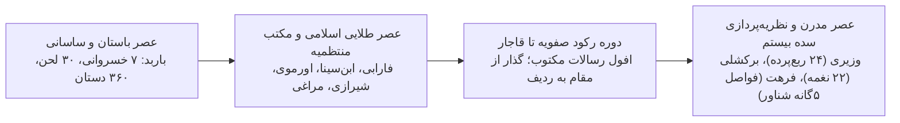
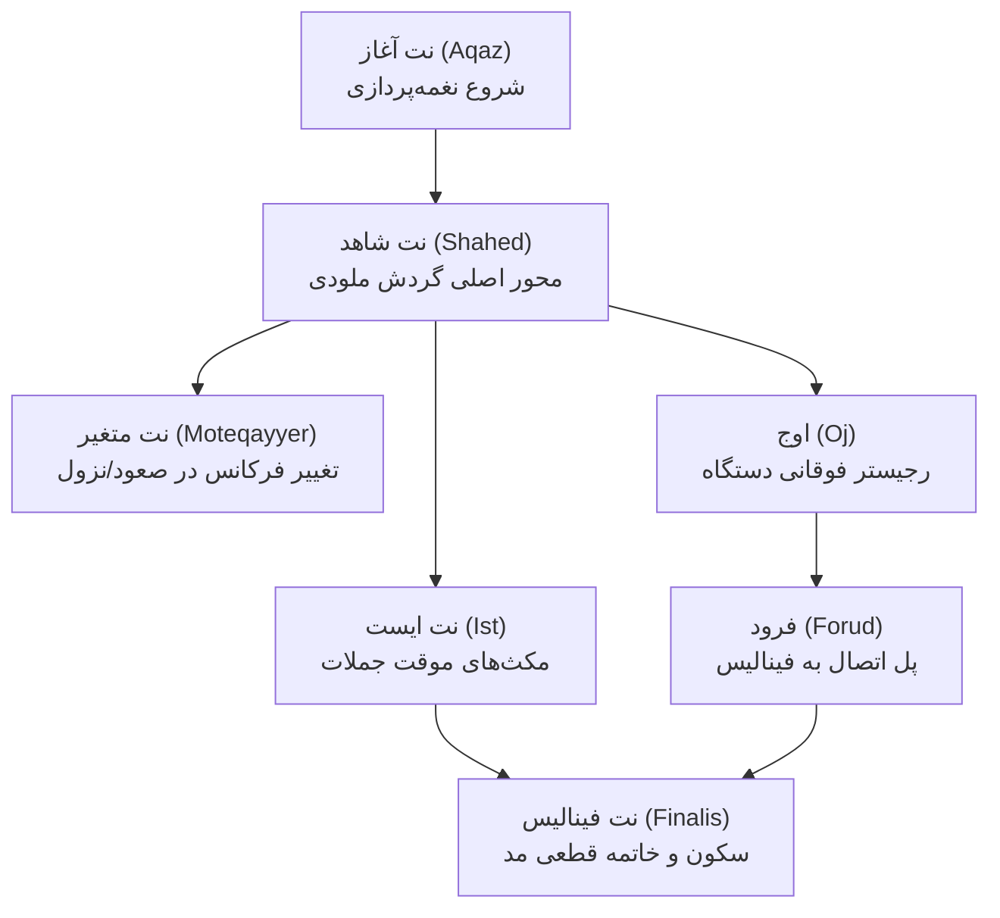
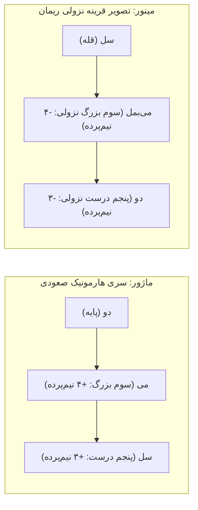

# درس‌نامه جامع و راهنمای مطالعاتی پژوهش‌های بنیادین موسیقی
## تبارشناسی مدال، فیزیک آکوستیک، معماری تنال غربی و پیوندهای اوراسیایی (ایران، بالکان و اروپای شرقی)
### تدوین و ویراست آکادمیک: بر پایه سلسله‌پژوهش‌های استودیوی EnamiX (ایمان بَرْزِجان) و متون مرجع اتنوموزیکولوژی

---

## فهرست فصول درس‌نامه

1. **فصل اول: چشم‌انداز کلی، فلسفه پژوهش و روش‌شناسی اتنوموزیکولوژی**
   - ۱.۱ مقدمه و پیوند ارگانیک تئوری، آکوستیک و مطالعات میدانی
   - ۱.۲ روش‌شناسی هرمز فرهت؛ ابطال تئوری‌های انتزاعی با ابزارهای آکوستیکی
   - ۱.۳ تمایز ساختاری موسیقی هنری شهری (دستگاهی) و موسیقی مردمی (فولکلور)

2. **فصل دوم: دیرینه‌شناسی تاریخی و مجاری سه‌گانه پیوند فرهنگی-زبانی اوراسیا**
   - ۲.۱ لایه باستانی: سکاها، سرمت‌ها، آلان‌ها و بقایای زبانی در حوزه کارپات-دانوب
   - ۲.۲ لایه میانه: کوچ قوم روما (کولی‌ها) و ردپای واژگانی-آوایی زبان فارسی
   - ۲.۳ لایه عثمانی: نفوذ اداری، بزم‌نگاری، اصطلاحات تصوف و موسیقی
   - ۲.۴ گاه‌شمار تحول تاریخی سیستم‌های نظری موسیقی در فلات ایران

3. **فصل سوم: کالبدشکافی فواصل و ابطال نظریه‌های گام‌محور در موسیقی ایرانی**
   - ۳.۱ نقد علمی و ابطال سیستم ۲۴ ربع‌پرده‌ای علینقی وزیری
   - ۳.۲ نقد علمی و ابطال تئوری ۲۲ نغمه‌ای مهدی برکشلی
   - ۳.۳ تبیین سیستم فواصل پنج‌گانه شناور هرمز فرهت ($m, n, N, M, P$)
   - ۳.۴ سوم خنثی زلزل؛ هویت آکوستیک شرق و بالکان
   - ۳.۵ جدول مقایسه‌ای جامع سیستم‌های کوک و ابعاد آکوستیکی فواصل

4. **فصل چهارم: هندسه تنال و رفتار مدال در ۱۲ مجموعه ردیف موسیقی ایرانی**
   - ۴.۱ بازتعریف درجات تنال در برابر کلیشه‌های هارمونی غربی
   - ۴.۲ کالبدشکافی تحلیلی ۷ دستگاه و ۵ آواز (شاهد، ایست، فینالیس، متغیر، اوج، فرود)
   - ۴.۳ جدول ماتریسی رفتار تنال، حرکت ملودی و اقلیم عاطفی ۱۲ مجموعه ردیف

5. **فصل پنجم: تبارشناسی، فیزیک صوت و هارمونی گام‌های ماژور و مینور غربی**
   - ۵.۱ آکوستیک سری هارمونیک، نسب فیثاغورثی، کومای فیثاغورثی و سنتونیک
   - ۵.۲ اعتدال مساوی دوازده‌نغمه‌ای (12-TET)؛ دستاوردها و سرکوب فواصل شرقی
   - ۵.۳ تکامل نام‌گذاری و سلفژ: از هگزاکورد گوییدو د آرتزو تا سلفژ متحرک
   - ۵.۴ رساله دوازده‌مود گلارئان، سنت موزیکا فیکتا و تولد تونالیته ماژور/مینور
   - ۵.۵ معماری هارمونیک: نظریه رامو، کشش تریتون و نظریه دوگانگی ریمان
   - ۵.۶ ساختار سه‌گانه مینور (طبیعی، هارمونیک، ملودیک) و بحران آکوستیکی دوم افزوده
   - ۵.۷ انشعابات مدرن: گام‌های آکوستیک (بارتوک/لندوای)، پنتاتونیک و ماژور بیباپ

6. **فصل ششم: مطالعات تطبیقی و پیوندهای آکوستیک-زیست‌مکانیکی ایران و بالکان**
   - ۶.۱ ریتم پارلاندو-روباتو در آواز دوینا (Doina) و تطابق با ردیف آوازی
   - ۶.۲ ارگانولوژی مقایسه‌ای هورن‌بوستل-زاکس: سنتور/تسامبال، تنبور/کوبزا، نای/کاوال
   - ۶.۳ زیست‌مکانیک حنجره: تحریر چکشی/قفلی ایرانی در برابر هوریا کو نودوری و ضربات چاکنایی رومانی
   - ۶.۴ هم‌ترازی نشانه‌شناختی مفهوم «Dor» در رومانی با «فراق»، «سوز» و «حزن استعلایی»
   - ۶.۵ اسناد تاریخی دیمیتری کانتکیر، آنتون پان و ضبط‌های بلا بارتوک و بریلویو

7. **فصل هفتم: راهنمای پداگوژیک و مکانیسم‌های اجرایی ساز ویولن**
   - ۷.۱ ویولن به عنوان ساز بدون پرده (Fretless)؛ سنتز غرب و شرق
   - ۷.۲ سیستم پداگوژیک کارل فلش، اوتاکار سوچیک و اینتونیشن بیانی پابلو کازالس
   - ۷.۳ راهنمای گام‌به‌گام انگشت‌گذاری دست چپ برای فواصل خنثی ($n, N$) و پالس‌تون ($P$)
   - ۷.۴ کوک‌های سنتی ویولن در موسیقی دستگاهی و رزونانس سیم‌های آزاد
   - ۷.۵ نقشه راه ۵‌گانه تمرینات روزانه هنرجویان

8. **جمع‌بندی نهایی و افق‌های نوین در اتنوموزیکولوژی**
   - جدول کلان‌سنتز مطالعاتی

---

## فصل اول: چشم‌انداز کلی، فلسفه پژوهش و روش‌شناسی اتنوموزیکولوژی

### ۱.۱ مقدمه و پیوند ارگانیک تئوری، آکوستیک و مطالعات میدانی
بازخوانی علمی و آسیب‌شناسانه تئوری موسیقی در دهه‌های اخیر، مستلزم عبور از دو آفت موازی بوده است:
1. **کلیشه‌های جزم‌گرایانه سنتی:** آموزش‌های شفاهی و سینه‌به‌سینه که با حذف منطق ساختاری، دستگاه‌ها را تنها در دایره حفظ ردیف بدون درک فیزیک صوت و رفتار مدال تعریف می‌کردند.
2. **تقلیل‌گرایی یوروپاسنتریک (Eurocentric):** تحمیل الگوهای تنبوشه‌ای هارمونی کلاسیک غرب و نظام کوک تعدیل مساوی (12-TET) بر موسیقی تک‌صدایی و مدال شرق.

مجموعه‌پژوهش‌های تدوین‌شده توسط **ایمان بَرْزِجان** در استودیوی **EnamiX**، بر پایه پیوند ارگانیک میان **تحلیل تئوریک آکادمیک**، **فیزیک آکوستیک تجربی** و **بررسی‌های میدانی فرامرزی** شکل گرفته است. این رویکرد اثبات می‌کند که موسیقی ایران نه یک جزیره محصور و ایزوله، بلکه بخش پویایی از یک حوزه گسترده‌تر آکوستیکی و فرهنگی اوراسیایی است که با حوزه مدیترانه، بالکان و حوزه کارپات-دانوب اشتراکات کالبدی عمیق دارد.

### ۱.۲ روش‌شناسی هرمز فرهت؛ ابطال تئوری‌های انتزاعی با ابزارهای آکوستیکی
شالوده نظری بازنگری در ساختار ردیف بر کتاب مرجع **«مفهوم دستگاه در موسیقی ایران» (The Dastgah Concept in Persian Music)** نوشته **هرمز فرهت** (منتشرشده توسط انتشارات دانشگاه کمبریج) استوار است. این پژوهش، محصول رساله دکتری فرهت در دانشگاه کالیفرنیا، لس‌آنجلس (UCLA) تحت راهنمایی اتنوموزیکولوژیست شهیر **منتل هود (Mantle Hood)** است.

فرهت با دریافت بورس بنیاد فورد (۱۹۵۷–۱۹۵۹) به ایران بازگشت و روش‌شناسی بدیعی را پیاده ساخت:
* **فراگیری عملی ساز:** آموزش تار و سه‌تار نزد نصره‌الله زرین‌پنجه (شاگرد برجسته موسی معروفی و نماینده ردیف رسمی) و سنتور نزد حسین صبا.
* **ثبت میدانی:** بیش از ۱۰۰ ساعت ضبط صوتی ناب و تحلیل اختصاصی اجرای استادان برجسته‌ای چون احمد عبادی، فرامرز پایور، اصغر بهاری، جلیل شهناز و مهدی مفتاح.
* **آزمایشگاه آکوستیک:** اندازه‌گیری دقیق فرکانسی پرده‌بندی فیزیکی ۵ ساز اصیل (۲ تار و ۳ سه‌تار) متعلق به اساتید و پردازش رفتار صوتی آن‌ها با دستگاه‌های **«ملوگراف» (Melograph)** و **«استروبوکون» (Stroboconn)** در دانشگاه UCLA.

این رویکرد میدانی-تجربی، هرگونه نظریه‌پردازی انتزاعیِ پشت‌میزنشینی را باطل کرد و مبنای واقعی درک رفتار مدال ردیف گردید.

### ۱.۳ تمایز ساختاری موسیقی هنری شهری و موسیقی مردمی
در اتنوموزیکولوژی علمی، ایجاد تمایز ساختاری میان این دو حوزه نقشی کلیدی در فهم نظام مدال دارد:

| مؤلفه مقایسه | موسیقی هنری شهری (Urban Art Music / دستگاهی) | موسیقی مردمی / روستایی (Folk Music / مقامی منطقه‌ای) |
| :--- | :--- | :--- |
| **روش انتقال** | شفاهی اما فوق‌العاده مدون، کالبدی و منسجم در قالب «ردیف» میان نخبگان. | سینه به سینه، خودانگیخته، وابسته به لهجه‌ها، آیین‌ها و کارکردهای بومی. |
| **پیچیدگی مدال** | تنوع بسیار بالا (حدود ۶۰ مد مستقل و فرعی درون ۱۲ دستگاه و آواز). | ساختارهای ملودیک کوتاه‌تر، تکرارشونده و وابسته به شعر هجایی محلی. |
| **دینامیک بداهه** | بداهه‌نوازی پیشرفته بر پایه هسته‌های ملودیک (Nuclear Themes) و مدولاسیون گسترده. | بداهه‌پردازی در چارچوب موتیف‌ها و فرم‌های رقص یا سوگواری ثابت بومی. |

> [!NOTE]
> **نکته کلیدی و چکیده فصل:**
> موسیقی دستگاهی ایران نه با معیارهای گام‌های دو اکتاوی متقارن غربی، بلکه به عنوان یک «سیستم مدولار خطی و پویا» قابل ادراک است که هسته بنیادین آن بر روابط میکروتونال میان دانگ‌ها استوار شده است.

---

## فصل دوم: دیرینه‌شناسی تاریخی و مجاری سه‌گانه پیوند فرهنگی-زبانی اوراسیا

### ۲.۱ لایه‌های سه‌گانه پیوستار اوراسیایی
پیوندهای صوتی و ساختاری میان فلات ایران، شبه‌جزیره بالکان و حوزه اروپای شرقی (کارپات-دانوب و رومانی) حاصل تصادف نیست، بلکه بر سه مجرای تاریخی و ژئوپلیتیک متکی است:

1. **لایه کهن باستانی (استقرار طوایف ایرانی‌تبار سکا، سرمت و آلان):**
   در هزاره نخست پیش از میلاد تا سده‌های آغازین میلادی، دشت‌های شمال دریای سیاه و حوضه رود دانوب زیستگاه طوایف ایرانی‌تبار بود. نام‌های تاریخی نظیر شهر **یاش (Iași)** در رومانی (تختگاه باستانی شاهزاده‌نشین مولداوی) و منطقه **یاس‌شاگ (Jászság)** در دشت پانونی مجارستان مستقیماً از تبار **«یاسی‌ها» (شاخه غربی آلان‌ها/ایرانیان باستان)** اقتباس شده است که زبان آن‌ها تا قرون وسطی تکلم می‌شد و نزدیک‌ترین خویشاوند زنده آن، زبان آسی در قفقاز شمالی است.
2. **لایه میانه (مهاجرت تاریخی قوم روما - Roma):**
   قوم روما (کولی‌ها) پس از خروج از شبه‌قاره هند، قرن‌ها در جغرافیای فرهنگی و زبانی ایران زیستند. این توقف تاریخی موجب نفوذ واژگان بنیادین فارسی به هسته واژگانی زبان رومی (Romani) گردید: نظیر *baxt* (بخت/شانس)، *xulaj* (ارباب/صاحب، از ریشه خدای/کدخدا)، *tast* (تشت/جام)، و حتی ورود واج سایشی ملاطی بی‌واک «خ» به آواشناسی زبان آن‌ها پیش از پراکندگی در بالکان و رومانی. روماها برجسته‌ترین حاملان موسیقی حرفه‌ای در این مناطق شدند.
3. **لایه اداری-فرهنگی عثمانی (عصر حاکمیت فناریوت‌ها و اشراف بویار):**
   زبان فارسی به عنوان زبان ادب دیوانی و تصوف در قلمرو عثمانی، مجرای سوم انتقال بود. صدها اصطلاح و واژه پیرامون بزم و موسیقی از طریق ترکی عثمانی وارد زبان رومانیایی و اسلاوی شد: نظیر *perdea* (پرده نغمه)، *ciorbă* (شوربا)، *chihlimbar* (کهربا)، *dușman* (دشمن)، *ibric* (ابریق)، *zarzavat* (سبزیجات)، *palavragiu* (پلاوه‌گو/پرحرف) و *chef* (کیف/سرور و بزم).

### ۲.۲ گاه‌شمار سیر تحول تاریخی نظریه موسیقی در ایران

| دوره تاریخی | چهره‌ها و آثار کلیدی | دستاوردها و وضعیت ساختاری سیستم مدال |
| :--- | :--- | :--- |
| **ساسانیان (۲۲۶–۶۴۲ م)** | باربد، نکیسا، بامشاد، رامتین، آزاد، سرکش | سامان‌دهی ساختار مدال در قالب ۷ مد شاهوار (خسروانی)، ۳۰ لحن و ۳۶۰ دستان هماهنگ با تقویم؛ عناوین تصویری/روایی نظیر کین ایرج، باغ شیرین، هفت گنج. |
| **عصر عباسی و مکتب منتظمیه (۷۵۰–۱۴۳۴ م)** | ابراهیم و اسحاق موصلی، ابونصر فارابی (*کتاب الموسیقی الکبیر*)، ابوالفرج اصفهانی (*الأغانی*)، ابن‌سینا، صفی‌الدین اورموی (*الأدوار*)، قطب‌الدین شیرازی، عبدالقادر مراغی (*جامع‌الألحان*) | نگارش نظری به زبان مشترک علمی؛ تدوین نظام دایره‌های مدال (ادوار)، سیستم ۱۷ نغمه‌ای فیثاغورثی بر مبنای دستان‌بندی عود، و تدوین نوتیشن ابجدی برای ثبت رپرتوار. |
| **صفویه و قاجار (۱۵۰۱–۱۹۲۵ م)** | خاندان فراهانی (علی‌اکبر، غلامحسین، میرزا عبدالله، حسینقلی) | تبدیل سیستم کهن مقام‌ها به سیستم **۱۲ مجموعه ردیف دستگاهی** (۷ دستگاه و ۵ آواز) به منظور صیانت از هویت ملودیک و امکان مدولاسیون زنجیره‌ای در بداهه‌نوازی. |
| **سده بیستم و معاصر** | علینقی وزیری، مهدی برکشلی، هرمز فرهت، مسعودیه | برخورد با مدرنیته غرب؛ مناقشه بر سر اعتدال مساوی؛ ابطال فرضیه‌های ربع‌پرده‌ای با ثبت دقیق آکوستیکی و اتنوموزیکولوژیک. |

> [!NOTE]
> **نکته کلیدی و چکیده فصل:**
> ساختار موسیقی ایرانی در یک فرایند تاریخی از مدهای روایی ساسانی به ادوار ادراکی مکتب منتظمیه و سرانجام به معماری مدولار ردیف قاجار تکامل یافته است؛ هم‌زمان پیوندهای زبانی-جمعیتی اوراسیا بستری واحد برای تبادل نغمگی میان ایران و بالکان پی‌ریزی کرده است.

---

## فصل سوم: کالبدشکافی فواصل و ابطال نظریه‌های گام‌محور در موسیقی ایرانی

### ۳.۱ نقد علمی و ابطال تئوری ۲۴ ربع‌پرده‌ای علینقی وزیری
علینقی وزیری در دهه ۱۹۲۰ با انتشار کتب *دستور تار* (۱۹۲۲) و *موسیقی نظری* (۱۹۳۴)، سیستم اعتدال مساوی ۲۴ ربع‌پرده‌ای (هر فاصله معادل دقیق ۵۰ سانت) را مطرح کرد. او با انگیزه ایجاد هارمونی و چندصدایی به سبک غرب، موسیقی تک‌صدایی ایران را نیازمند تعدیل دانست.

**دلایل علمی ابطال نظریه وزیری:**
1. **مصنوعی بودن ربع‌پرده:** در آکوستیک موسیقی ایرانی هیچ فاصله‌ای دقیقاً معادل ۵۰ سانتیمتر آکوستیکی ($50\text{ cents}$) وجود ندارد. فواصل اصیل ریزپرده‌ای هرگز مضرب ریاضی ۲۵ یا ۵۰ نیستند.
2. **تخریب کیفیت خنثی:** تعدیل متساوی، نوسان و لطافت ویژه پرده‌های خنثی را از میان می‌برد و آن را به اصوات زمخت مکانیکی تبدیل می‌کند.
3. **ماندگاری کاربردی علائم عرضی:** با وجود ابطال فیزیکی سیستم، دو علامت ابداعی وزیری یعنی **«کُرُن» ($p$)** (کمی بم‌تر از بمل، حدود ۳۰ تا ۶۰ سانت) و **«سُری» ($t$)** (کمی زیرتر از دیز) به عنوان نمادهای راهگشای نگارشی پذیرفته شدند.

### ۳.۲ نقد علمی و ابطال تئوری ۲۲ نغمه‌ای مهدی برکشلی
مهدی برکشلی در دهه ۱۹۴۰ با اتکا به اندازه‌گیری صدای ۵ خواننده، مدعی شد موسیقی معاصر ایران منطبق بر گام ۲۲ نغمه‌ای مشتق از سیستم ۱۷ نغمه‌ای صفی‌الدین اورموی است که بر پایه فواصل فیثاغورثی **لیما** ($L = 90\text{ cents}$) و **کاما** ($C = 24\text{ cents}$) تدوین شده است.

**دلایل علمی ابطال نظریه برکشلی توسط هرمز فرهت:**
1. **خطای ریاضی:** برکشلی فاصله شبیه‌سازی‌شده $120\text{ c}$ ($d^\flat_2$) را معادل ترکیب $L + C$ خواند؛ درحالی‌که در سیستم فیثاغورثی:
   $$L + C = 90 + 24 = 114\text{ cents} \neq 120\text{ cents}$$
2. **غیرقابل‌اعتماد بودن صدای حنجره خوانندگان:** حنجره فاقد تقسیم‌بندی صلب فیزیکی است و فرکانس خود را با کوک ساز همراه تطبیق می‌دهد؛ ازاین‌رو نمی‌تواند مبنای آزمایشگاهی قرار گیرد.
3. **فرض غلط کانتینر هفت‌نغمه‌ای:** برکشلی یک گام فرضی هفت‌تنی (نظیر میکسولیدین) را ظرف اصلی پنداشت و باقی درجات را حاصل «تقسیم پرده» دانست. درحالی‌که در موسیقی ایرانی، اگر نغمه کُرن‌دار ($D^p$) اجرا شود، جایگزین نغمه اصلی ($D$) می‌گردد و هرگز دو نغمه هم‌نام به صورت کروماتیک کنار هم خوانده نمی‌شوند.

### ۳.۳ تبیین فواصل پنج‌گانه شناور هرمز فرهت
فرهت با اندازه‌گیری پرده‌های سازهای اساتید، اثبات کرد که مفهوم «گام ثابت اکتاوی» در موسیقی ایران وجود ندارد و نغمات درون تتراکوردها (دانگ‌ها) از پنج فاصله بنیادی شناور شکل می‌گیرند:

1. **دوم کوچک یا نیم‌پرده ($m$ - Minor 2nd):** حدود $90\text{ cents}$ (معادل لیمای فیثاغورثی؛ فشرده‌تر از نیم‌پرده معتدل غربی که $100\text{ c}$ است).
2. **دوم خنثی کوچک ($n$ - Small Neutral 2nd):** حدود $135\text{ cents}$ (با دامنه شناوری $125\text{ c}$ تا $145\text{ c}$).
3. **دوم خنثی بزرگ ($N$ - Large Neutral 2nd):** حدود $160\text{ cents}$ (با دامنه شناوری $150\text{ c}$ تا $170\text{ c}$).
4. **دوم بزرگ یا پرده ($M$ - Major 2nd):** حدود $204\text{ cents}$ (معادل دو لیما و یک کاما $2L+C$؛ بازتر از پرده معتدل غربی که $200\text{ c}$ است).
5. **پالس‌تون ($P$ - Plus-tone):** حدود $270\text{ cents}$ (فاصله‌ای میان دوم بزرگ $204\text{ c}$ و سوم کوچک غربی $300\text{ c}$ که ویژه دستگاه چهارگاه و همایون است و پیش از فرهت نام تئوریک مستقلی نداشت).

### ۳.۴ سوم خنثی زلزل (Neutral 3rd)
یکی از کهن‌ترین و زیباترین فواصل موسیقی شرق، **وسطه زلزل** یا **سوم خنثی** با دامنه $340\text{ c}$ تا $365\text{ c}$ است. این فاصله حاصل جمع یک پرده و یک دوم خنثی ($M + n$) یا یک پالس‌تون و یک نیم‌پرده ($P + m$) است که به نام منصور زلزل (سده دوم هجری، استاد اسحاق موصلی) بر دسته لوت و عود تثبیت شد. این نغمه روح حزن‌انگیز آوازهای دشتی، شوشتری، سه‌گاه و فرم دوینا در بالکان را می‌سازد.

### ۳.۵ جدول مقایسه‌ای جامع سیستم‌های کوک و ابعاد آکوستیکی فواصل

| نام فاصله و ماهیت مدال | ارزش در اعتدال مساوی غربی (12-TET) | ارزش در سیستم هرمز فرهت | ارزش آزمایشگاهی در ردیف ایرانی | ارزش میدانی ثبت‌شده در بالکان و رومانی |
| :--- | :--- | :--- | :--- | :--- |
| **نیم‌پرده (بقیه / دوم کوچک)** | $100\text{ cents}$ | $m \approx 90\text{ c}$ | $90 - 95\text{ cents}$ | $90 - 110\text{ cents}$ |
| **دوم خنثی کوچک (کُرن)** | فاقد تعریف (مسخ در نیم‌پرده/پرده) | $n \approx 135\text{ c}$ | $130 - 142\text{ cents}$ | $135 - 145\text{ cents}$ (در نوحه‌های اولتنیا) |
| **دوم خنثی بزرگ** | فاقد تعریف | $N \approx 160\text{ c}$ | $155 - 168\text{ cents}$ | $150 - 165\text{ cents}$ |
| **دوم بزرگ (طنین / پرده کامل)** | $200\text{ cents}$ | $M \approx 204\text{ c}$ | $202 - 206\text{ cents}$ | $195 - 205\text{ cents}$ |
| **سوم خنثی (وسطه زلزل)** | فاقد تعریف (بین سوم کوچک و بزرگ) | $M + n \approx 345\text{ c}$ | $340 - 355\text{ cents}$ | $340 - 365\text{ cents}$ (دوئینای بارتوک) |
| **پالس‌تون (افزوده تعدیل‌نیافته)** | $300\text{ cents}$ (سوم کوچک غربی) | $P \approx 270\text{ c}$ | $265 - 275\text{ cents}$ | $270 - 310\text{ cents}$ (ترانه‌های لوترها) |

> [!NOTE]
> **نکته کلیدی و چکیده فصل:**
> در موسیقی ایرانی هیچ کانتینر اکتاوی صلبی وجود ندارد؛ رفتار نغمات توسط پنج فاصله شناور ($m, n, N, M, P$) درون ریزساختارهای دانگ رقم می‌خورد که با سیستم‌های کوک ۲۴ ربع‌پرده‌ای وزیری و ۲۲ تنی برکشلی ناسازگار است.

---

## فصل چهارم: هندسه تنال و رفتار مدال در ۱۲ مجموعه ردیف موسیقی ایرانی

### ۴.۱ بازتعریف درجات تنال در برابر کلیشه‌های هارمونی غربی
در نظریه موسیقی ایرانی، مفاهیم هارمونیک غربی نظیر «تونیک» (Tonic) یا «دومینانت» (Dominant) به دلیل بار معنایی آکوردال کاملاً مردود است. به‌جای آن، اصطلاحات دقیق زیر کارکرد ملودیک درجات را تعریف می‌کنند:

* **فینالیس ($F$ - Finalis):** نغمه سکون قطعی، خاتمه و آرامش نهایی مد.
* **آغاز ($A$ - Aqaz):** نغمه‌ای که جملات و فیگورهای ملودیک از آن شروع می‌شوند.
* **ایست ($I$ - Ist):** نغمه توقف موقت در پایان عبارات ملودیکِ گوشه‌ها پیش از وصل به فینالیس.
* **شاهد ($S$ - Shahed):** نغمه ثقل و محوری‌ترین نت که خط ملودی مدام حول آن طواف می‌کند.
* **متغیر ($M$ - Moteqayyer):** نغمه‌ای که فرکانس آن در سیر صعودی یا نزولی ملودی تغییر ریزپرده‌ای می‌یابد.
* **اوج ($Oj$):** اوج فرکانسی ردیف که در رجیستر صوتی بالا به نمایش درمی‌آید.
* **فرود ($Forud$):** زنجیره ملودیک متصل‌کننده گوشه‌های فرعی به فینالیس مد درآمد.

### ۴.۲ کالبدشکافی تحلیلی ۷ دستگاه و ۵ آواز

#### ۱. دستگاه شور (مادر دستگاه‌ها)
* **فواصل دانگ اول:** $C - D^p - E^\flat - F$ (الگوی فواصل: $n - N - M$).
* **نقش‌ها:** فینالیس = $C$، شاهد = $C$ (در برخی گوشه‌ها $F$)، آغاز = $B^p$ یا $C$، متغیر = درجه پنجم (در صعود $A^p$ و در نزول متمایل به $A^\flat$).
* **گوشه‌های کلیدی:** درآمد، شهناز (اوج روی درجه ۴ و ۵)، حسینی، قرچه، گرایلی.

#### ۲. آواز ابوعطا (مشتق از شور)
* **نقش‌ها:** فینالیس = درجه ۱ شور ($C$)، شاهد = درجه ۴ شور ($F$)، متغیر = درجه ۵ شور ($G \leftrightarrow A^p$).
* **گوشه‌های کلیدی:** رامکلی، خسروشیرین، سیخی، حجاز (اوج ابوعطا با تمرکز بر درجه پنجم شور).

#### ۳. آواز دشتی (مشتق از شور)
* **نقش‌ها:** فینالیس = درجه ۱ شور ($C$)، شاهد = درجه ۵ شور ($G$)، ایست = درجه ۳ شور ($E^\flat$)، متغیر = درجه ۵ ($G$ در حرکات نزولی تمایل به کُرن دارد).
* **کاراکتر:** اوج غم و نوستالژی روستایی؛ گوشه‌های بیدگانی، چوپانی، گیلکی، غم‌انگیز، دیلمان.

#### ۴. آواز بیات ترک / زند (مشتق از شور)
* **نقش‌ها:** فینالیس = درجه ۱ شور ($C$)، شاهد = درجه ۳ شور ($E^\flat$)، ایست = درجه ۱ شور ($C$)، متغیر = ندارد (ثبات فواصل).
* **گوشه‌های کلیدی:** درآمد، دوگاه، روح‌الأرواح، شکسته (مدولاسیون به ماهور).

#### ۵. آواز افشاری (مشتق از شور)
* **نقش‌ها:** فینالیس = درجه ۱ شور ($C$)، شاهد = درجه ۴ شور ($F$)، ایست = درجه ۲ شور ($D^p$)، متغیر = درجه ۵ شور ($G \leftrightarrow A^p$).
* **کاراکتر:** لحن سرگردان، مواج و دردناک؛ گوشه‌های بیات راجه، قرایی، عراق (اوج افشاری).

#### ۶. دستگاه همایون
* **فواصل دانگ اول:** $C - D^p - E - F$ (الگوی فواصل: $n - P - m$).
* **ویژگی متمایز:** فاصله پالس‌تون ($P \approx 270\text{ c}$) میان درجات دوم و سوم ($D^p$ تا $E$).
* **نقش‌ها:** فینالیس = $C$، شاهد = $C$، متغیر = درجات دوم ($D^p$) و ششم ($A^p$).
* **گوشه‌های کلیدی:** درآمد، چکاوک، شوشتری، بیداد (اوج بر روی درجه چهارم با شاهد $F$).

#### ۷. آواز بیات اصفهان (مستقل در ساختار، پیوند سنتی با همایون)
* **فواصل دانگ اول:** $C - D - E^p - F$ (الگوی فواصل: $M - n - N$).
* **دیدگاه هرمز فرهت:** برخلاف نظریه قدما که اصفهان را مشتق همایون می‌دانستند، فرهت نشان داد که اصفهان یک دستگاه مستقل است؛ زیرا شاهد آن ($F$)، الگوهای ملودیک، دانگ ابتدایی و حس مدال آن کاملاً هویتی جداگانه از همایون دارد.
* **گوشه‌های کلیدی:** درآمد، جامه‌دران، بیات شیراز، عشاق (اوج با وصل به شور).

#### ۸. دستگاه چهارگاه
* **فواصل گام:** دو دانگ متصل و متقارن: $C - D^p - E - F$ و $G - A^p - B - C$ (هر دو دانگ دارای الگوی $n - P - m$).
* **نقش‌ها:** فینالیس = $C$، شاهد = $C$ و در گوشه‌ها $E$، متغیر = ندارد (استحکام کامل فواصل پالس‌تون).
* **کاراکتر:** حماسی، پرصلابت، جهشی؛ گوشه‌های زابل (شاهد روی ۳)، حصار (مدولاسیون روی ۵)، مخالف (اوج روی ۶)، مغلوب.

#### ۹. دستگاه سه‌گاه
* **فواصل گام:** متکی بر درجات خنثی: $C - D^p - E^p - F - G - A^p - B^p - C$.
* **نقش‌ها:** فینالیس = درجه ۳ خنثی ($E^p$)، شاهد = درجه ۳ خنثی ($E^p$)، ایست = درجه ۳ ($E^p$)، متغیر = درجه ۶ ($A^p$).
* **کاراکتر:** نالان، پرعاطفه و دلتنگ؛ گوشه‌های زابل، مویه، مخالف (اوج پرشکوه بر درجه ششم)، مغلوب.

#### ۱۰. دستگاه ماهور
* **فواصل دانگ اول:** $C - D - E - F$ (الگوی فواصل: $M - M - m$).
* **نقش‌ها:** فینالیس = $C$، شاهد = $C$، متغیر = درجه ۶ ($A$ که در گوشه دلکش به $A^p$ تبدیل شده و به شور مدولاسیون می‌کند).
* **گوشه‌های کلیدی:** داد، خسروانی، فیلی، شکسته (فرود به افشاری)، دلکش، راک‌ها.

#### ۱۱. دستگاه راست‌پنجگاه
* **فواصل پایه:** منطبق بر ماهور ($C - D - E - F - G - A - B - C$).
* **ویژگی انحصاری:** دستگاه آموزش مدولاسیون عالی؛ امکان سفر نغمگی به همایون، اصفهان، شور و سه‌گاه.
* **گوشه‌های کلیدی:** درآمد راست، پنجگاه، پروانه، نغمه، عشاق، بحر نور.

#### ۱۲. دستگاه نوا
* **فواصل پایه:** $C - D^p - E^\flat - F - G - A^p - B^\flat - C$ (شباهت نغمه‌ای با شور).
* **نقش‌ها:** فینالیس = $C$، شاهد = درجه ۴ ($F$)، متغیر = درجه ۵ ($G \leftrightarrow A^p$).
* **کاراکتر:** آرام، عارفانه، موقر، فیلسوفانه و نجیب؛ گوشه‌های نیشابورک، نیریز، خجسته، گَوَشت.

---

### ۴.۳ جدول ماتریسی رفتار تنال، حرکت ملودی و اقلیم عاطفی ۱۲ مجموعه ردیف

| نام مجموعه | وضعیت سیستمی | نت شاهد ($S$) | نت ایست ($I$) | نت فینالیس ($F$) | نت متغیر ($M$) | جهت سیر ملودی | اقلیم عاطفی و بیانی |
| :--- | :--- | :--- | :--- | :--- | :--- | :--- | :--- |
| **شور** | دستگاه مستقل (مادر) | درجه ۱ ($C$) / درجه ۴ ($F$) | درجه ۱ ($C$) | درجه ۱ ($C$) | درجه ۵ ($A^p \leftrightarrow A^\flat$) | صعودی-نزولی متوازن | عمیق، تأمل‌برانگیز، گسترده |
| **ابوعطا** | آواز (متعلق به شور) | درجه ۴ شور ($F$) | درجه ۱ شور ($C$) | درجه ۱ شور ($C$) | درجه ۵ شور ($A^p$) | نزولی متمایل به ۴ | سوزناک، حزین، روایی |
| **دشتی** | آواز (متعلق به شور) | درجه ۵ شور ($G$) | درجه ۳ شور ($E^\flat$) | درجه ۱ شور ($C$) | درجه ۵ شور ($G \rightarrow G^p$) | صعود به ۵ و فرود به ۳ | غم‌انگیز، جانسوز، نوستالژی چوپانی |
| **بیات ترک** | آواز (متعلق به شور) | درجه ۳ شور ($E^\flat$) | درجه ۱ شور ($C$) | درجه ۱ شور ($C$) | ندارد (ثابت) | صعودی از درجه ۳ | شاداب، عارفانه، پرامید |
| **افشاری** | آواز (متعلق به شور) | درجه ۴ شور ($F$) | درجه ۲ شور ($D^p$) | درجه ۱ شور ($C$) | درجه ۵ شور ($G \leftrightarrow A^p$) | نوسانی حول درجات ۴ و ۵ | دردناک، سرگردان، مواج |
| **همایون** | دستگاه مستقل | درجه ۱ ($C$) | درجه ۱ ($C$) | درجه ۱ ($C$) | درجه ۲ ($D^p$) و ۶ ($A^p$) | صعودی تدریجی دانگ اول | باشکوه، مجلل، اشرافی، پرصلابت |
| **بیات اصفهان**| دستگاه مستقل (دیدگاه فرهت)| درجه ۴ همایون ($F$)| درجه ۱ اصفهان ($C$) | درجه ۱ اصفهان ($C$) | درجه ۶ ($A^p$)| صعودی و نزولی موجی | تغزلی، عاشقانه، درون‌گرایانه |
| **چهارگاه** | دستگاه مستقل | درجات ۱ ($C$) و ۳ ($E$) | درجه ۱ ($C$) | درجه ۱ ($C$) | ندارد (ثبات فواصل پالس‌تون) | جهشی، پرتحرک، پویا | حماسی، شورانگیز، رزم‌گونه |
| **سه‌گاه** | دستگاه مستقل | درجه ۳ خنثی ($E^p$) | درجه ۳ خنثی ($E^p$) | درجه ۳ خنثی ($E^p$) | درجه ۶ ($A^p$) | مواج و نوسانی حول شاهد | نالان، پرشفقت، حسرت‌بار |
| **ماهور** | دستگاه مستقل | درجه ۱ ($C$) | درجه ۱ ($C$) | درجه ۱ ($C$) | درجه ۶ ($A \rightarrow A^p$ در دلکش)| صعودی مستقیم گام‌به‌گام | طرب‌انگیز، شاد، شکوهمند، پرنشاط |
| **راست‌پنجگاه**| دستگاه مستقل | درجه ۱ ($C$) | درجه ۱ ($C$) | درجه ۱ ($C$) | متغیر در سیر مدولاسیون‌ها | مارپیچ مدال و چرخشی | رازآلود، گسترده، متفکرانه |
| **نوا** | دستگاه مستقل | درجه ۴ ($F$) | درجه ۱ ($C$) | درجه ۱ ($C$) | درجه ۵ ($G$) | خطی، ملایم و پیوسته | زاهدانه، موقر، بسیار نجیب |

> [!NOTE]
> **نکته کلیدی و چکیده فصل:**
> دستگاه‌های موسیقی ایرانی برخلاف گام‌های متقارن غرب، دارای جهت‌گیری دراماتیک خطی هستند؛ هر گوشه با جابه‌جایی نت‌های شاهد و ایست، یک سفر مدال را خلق می‌کند که در فرود به آرامش فینالیس می‌رسد.

---

## فصل پنجم: تبارشناسی، فیزیک صوت و هارمونی گام‌های ماژور و مینور غربی

### ۵.۱ مبانی آکوستیک: سری هارمونیک و انباشت فواصل
گام ماژور (Major Scale) یک قرارداد دلبخواهی نیست، بلکه بازتاب قوانین فیزیک صوت در **سری هارمونیک‌ها (Harmonic Series)** است. هنگامی که یک سیم با فرکانس پایه مرتعش می‌شود، هارمونیک‌های چهارم، پنجم و ششم آن نسبت فرکانسی **۴:۵:۶** را می‌سازند که دقیقاً ساختار **آکورد سه صدایی ماژور در حالت پایگی** (نظیر $C - E - G$) است.

* **کومای فیثاغورثی (Pythagorean Comma):** انباشت ۱۲ فاصله پنجم درست خالص ($3:2$) اندکی از ۷ اکتاو کامل بزرگتر می‌شود ($531441:524288$ معادل **$23.46\text{ cents}$**).
* **کومای سنتونیک (Syntonic Comma):** تفاوت میان سوم بزرگ فیثاغورثی ($81:64$) و سوم بزرگ طبیعی در سری هارمونیک ($5:4$) که معادل نسبت $81:80$ یا **$21.51\text{ cents}$** است.

### ۵.۲ ظهور اعتدال مساوی دوازده‌نغمه‌ای (12-TET)
برای حل معضل کومای فیثاغورثی و سنتونیک و امکان مدولاسیون آزاد به تمامی ۲۴ کلید بدون مواجهه با **«فواصل گرگ» (Wolf Intervals)**، در قرون هفدهم و هجدهم سیستم تعدیل مساوی تثبیت شد:
$$c = 1200 \times \log_2\left(\frac{f_2}{f_1}\right)$$
در این سیستم، اکتاو به ۱۲ نیم‌پرده کاملاً مساوی ۱۰۰ سنتی تقسیم شد. بهای این مصالحه صنعتی:
* سوم‌های بزرگ ۱۴ سنت شارپ‌تر و پنجم‌ها ۲ سنت فشرده‌تر از کوک طبیعی شدند.
* **فواصل شناور و خنثی شرق ($n, N, P$) به طور کامل سانسور و سرکوب شدند.**

### ۵.۳ تکامل سیستم نام‌گذاری، سلفژ و مدهای کلیسایی
* **هگزاکورد گوییدو د آرتزو (Guido d'Arezzo - قرن ۱۱):** ابداع هجاهای *Ut, Re, Mi, Fa, Sol, La* بر اساس سرود مذهبی *Ut queant laxis*. نیم‌پرده همواره میان *Mi* و *Fa* قرار داشت.
* **تکمیل سلفژ:** در قرن هفدهم هجای *Ut* به دلیل دشواری آوازی توسط دوناتی به **Do** تبدیل شد؛ هجای **Si** برای درجه هفتم افزوده و سپس توسط سارا گلاور و جان کرون به **Ti** تغییر یافت تا سلفژ متحرک (**Tonic Sol-fa**) شکل گیرد.
* **رساله Dodecachordon هاینریش گلارئان (۱۵۴۷):** گسترش مدهای هشت‌گانه کلیسایی به ۱۲ مد با معرفی رسمی **مد یونین (Ionian - گام ماژور طبیعی با پایه Do)** و **مد ائولین (Aeolian - گام مینور طبیعی با پایه La)**.

### ۵.۴ معماری هارمونیک، تریتون و نظریه دوگانگی ریمان
* **ژان فیلیپ رامو (*Traité de l'harmonie* ۱۷۲۲):** رامو مفهوم **بیس بنیادی (Fundamental Bass)** را وضع کرد و نشان داد نیروی محرکه هارمونی تونال، تمایل شدید آکورد نمایان هفتم ($V^7$) به حل شدن در تونیک ($I$) است. فاصله ناپایدار **تریتون** (سه پرده کامل، نظیر $B - F$ در کلید دو ماژور) با کشش همگرا حل می‌شود: نت محسوس $B$ نیم‌پرده به بالا به سمت $C$ و نت $F$ نیم‌پرده به پایین به سمت $E$ حرکت می‌کند.
* **نظریه دوگانگی هارمونیک (Harmonic Dualism):** آرتور فون اوتینگن و هوگو ریمان استدلال کردند که گام ماژور زاییده سری هارمونیک رو به بالا است و گام مینور، تصویر آینه‌ای و قرینه دقیق آن در جهت پایین‌رونده آکوستیکی است.

### ۵.۵ تبارشناسی و ساختار سه‌گانه گام‌های مینور
در گام مینور، برخلاف ماژور، فاصله میان درجه هفتم و هشتم یک پرده کامل است و گام فاقد کشش محسوسه به تونیک است. آهنگسازان عصر باروک از طریق سنت **موزیکا فیکتا (Musica Ficta)** برای تقویت کادانس‌ها، اشکال سه‌گانه مینور را پدید آوردند:

1. **مینور طبیعی (Natural Minor / ائولین):**
   * الگو: $W - H - W - W - H - W - W$ (در لا مینور: $A-B-C-D-E-F-G-A$).
   * فاقد نت محسوس؛ در باروک اغلب با **سرکلید دورین (Dorian Key Signature)** با یک بمل کمتر نوشته می‌شد (نظیر آثار باخ).
2. **مینور هارمونیک (Harmonic Minor):**
   * برای ایجاد نت محسوس، درجه هفتم نیم‌پرده کروماتیک زیر می‌شود ($G \rightarrow G^\sharp$).
   * **بحران آکوستیک:** پدید آمدن فاصله نامتعارف **دوم افزوده (Augmented 2nd)** میان درجات ششم و هفتم ($F$ تا $G^\sharp$) به وسعت $300\text{ cents}$ که در کوک طبیعی نسبت نامطبوع $75:64$ دارد و خواندن آوازی آن دشوار است.
3. **مینور ملودیک (Melodic Minor):**
   * برای هموار کردن خط ملودی آوازی، در حالت صعودی هر دو درجه ششم و هفتم زیر می‌شوند ($F^\sharp$ و $G^\sharp$) و دانگ فوقانی به دانگ ماژور بدل می‌شود. در حالت نزولی، برای بازگشت به حس درون‌گرایانه، هر دو نغمه بکار شده و به مینور طبیعی بازمی‌گردد.

### ۵.۶ انشعابات مدرن: گام‌های آکوستیک، پنتاتونیک و بیباپ
* **گام آکوستیک (Acoustic Scale / لیدین بمل ۷):** با ساختار $C - D - E - F^\sharp - G - A - B^\flat - C$؛ مستقیماً از تقریب فرکانس‌های هارمونیک هشتم تا چهاردهم استخراج شده است. بلا بارتوک از این گام بهره فراوان برد و ارنو لندوای (Ernő Lendvai) در تحلیل‌های خود نشان داد که این گام چگونه ساختار هندسی نظام محوری (Axis System) بارتوک را می‌سازد.
* **گام پنتاتونیک ماژور ($C - D - E - G - A$):** فاقد فواصل نیم‌پرده و تریتون؛ حداقل دیسونانس ممکن در بداهه‌نوازی.
* **گام ماژور بیباپ (Bebop Major Scale):** با افزودن یک نغمه کروماتیک گذرا میان درجات ۵ و ۶ ($C-D-E-F-G-G^\sharp-A-B-C$) ابداع شد تا نغمات پایه‌ای آکورد در ضرب‌های فرد (ضرب قوی) قرار گیرند و تقارن ریتمیک چنگ‌ها در ضرب ۴/۴ حفظ شود.

> [!NOTE]
> **نکته کلیدی و چکیده فصل:**
> گام ماژور تجلی مستقیم فیزیک صوت در سری هارمونیک، و گام مینور تکامل تاریخی برای مهار کشش‌های دراماتیک است؛ تثبیت 12-TET این دو قطب را بر جهان مسلط ساخت اما گوش را به نغمات خنثی بیگانه کرد.

---

## فصل ششم: مطالعات تطبیقی و پیوندهای آکوستیک-زیست‌مکانیکی ایران و بالکان

### ۶.۱ ریتم پارلاندو-روباتو در فرم دوینا و تطابق با ردیف آوازی
مطالعات میدانی اتنوموزیکولوژیست شهیر **کنستانتین بریلویو (Constantin Brăiloiu)** و آهنگساز مجار **بلا بارتوک** در رومانی نشان داد که فرم آوازی **دوئینا (Doina)** از ریتم **پارلاندو-روباتو (Parlando-Rubato)** پیروی می‌کند. در این فرم:
* ریتم به طور کامل تابع تکیه‌ها و دکلماسیون هجاهای کلامی است و فاقد متر ثابت و ضرب‌بندی مشخص است.
* خط ملودیک دقیقاً مشابه گوشه‌های آوازی ردیف ایران (نظیر دشتستانی، شوشتری و درآمد شور) روی یک نغمه شاهد توقف می‌کند، با تزئینات ریز نوسان می‌یابد و سپس با فرودی فرمولیزه‌شده به نغمه سکون می‌رسد.
* وجود فواصل سوم خنثی ($340-365\text{ c}$) در سرودهای باستانی سوگواری اولتنیا (*Cântecul zorilor* - سرود سپیده‌دم و *Cântece de mort* - سرودهای مرگ) خویشاوندی فیزیکی این دو حوزه را اثبات کرد.

### ۶.۲ ارگانولوژی مقایسه‌ای بر پایه سیستم هورن‌بوستل-زاکس
سیر تکاملی سازها در این گستره جغرافیایی نشان‌دهنده یک شجره‌نامه سازشناسی واحد است:

| رده هورن‌بوستل-زاکس | شاخه فلات ایران و خاورمیانه | شاخه بالکان و حوزه کارپات (رومانی/مجارستان) | ویژگی‌های ساختاری و اشتراکات تکنیکی |
| :--- | :--- | :--- | :--- |
| **۳۱۴.۱۲۲** (کوردوفون زهی مضرابی/جعبه‌ای) | **سنتور (Santur)** | **تسامبال (Țambal)** و **چیمبالوم (Cimbalom)** | جعبه تشدید ذوزنقه‌ای؛ تقسیم خرک‌ها؛ تسامبال در دست نوازندگان رومی (نظیر تونی یوردایه Toni Iordache) همان تکنیک ریزها (*Tremolo*) و تکیه‌ها (*țituri*) سنتور ایرانی را با مضراب‌های سرپوش‌دار نمدی اجرا می‌کند. |
| **۳۲۱.۳۲۱** (کوردوفون دسته‌دار لوت) | **تنبور (Tanbur) و سه‌تار** | **تامبوریتزا (Tamburitza)** و **کوبزا (Cobza)** | لوت‌های دسته بلند در بالکان به تامبوریتزا و تامبورا تبدیل شدند؛ ساز «کوبزا» در رومانی لوت دسته کوتاه بدون پرده است که با مضراب پر غاز برای همراهی ضربی و آکوردهای واخوان (*a ține hangul*) نواخته می‌شود. |
| **۴۲۱.۱۱۲** (آئروفون‌های لوله‌ای لب‌صدا) | **نی، لَله‌وا، نی‌انبان** | **نای (Nai - فلوت پن)**، **کاوال (Caval)**، **فلویر (Fluier)** | دمیدن بر لبه بدون سرپوش لوله استخوانی یا چوبی؛ ایجاد صدای بم زنگ‌دار خُرناسی با تشدید حلقی حنجره نوازنده حین دمیدن در لَله‌وا و کاوال شبانی. |

### ۶.۳ زیست‌مکانیک حنجره: تحریر ایرانی در برابر تکنیک‌های آوازی رومانی
بررسی آکوستیک حنجره نشان می‌دهد که تکنیک تزئینات آوازی در هر دو فرهنگ بر فیزیولوژی یکسانی متکی است:

1. **تحریر چکشی و بلبلی ایرانی:**
   مکانیسم تحریر بر انقباض و رهایش ناگهانی ماهیچه‌های حنجره، به‌ویژه عضلات آریتنوئید و کنترل شکاف چاکنای (**Glottis**) استوار است. خواننده با قطع و وصل فوق‌العاده سریع فشار هوا، جهش‌های فرکانسی پرشی (میکروتونال) در فواصل دوم کوچک یا خنثی خلق می‌کند.
2. **تکنیک ضربه چاکنایی رومانی (*Lovitură de glotă*) و گره صوتی (*Nod*):**
   در سنت آوازی منطقه مارامورش (*Maramureș*) در شمال رومانی، آوازی به نام **«هوریا کو نودوری» (*Horea cu noduri* - آواز گره‌دار)** وجود دارد. خواننده با مسدود کردن آنی جریان هوا در چاکنای و سپس رهاسازی انفجاری، صدای سکسکه‌مانندی پدید می‌آورد که در رجیستر فالستو پرتاب می‌شود. این گره‌های متوالی صوتی، آکوستیکی کاملاً منطبق بر تحریرهای قفلی ردیف آوازی ایران دارد.
3. **فریادهای هایولیت (*Hăulit*):**
   پرتاب سیگنال‌های صوتی به سقف رجیستر حنجره با پرش‌های اکتاوی، دقیقاً منطبق بر آوازهای گله‌داری و پهلوانی زاگرس و البرز است.

### ۶.۴ هم‌ترازی نشانه‌شناختی مفهوم «Dor» با «فراق»، «سوز» و «حزن استعلایی»
از منظر اتنوموزیکولوژی ادراکی، واژه رومانیایی **«دور» (Dor)** مفهومی غیرقابل‌ترجمه است که آمیزه‌ای از دلتنگی عمیق، اشتیاق دردناک، حس غربت، و یاد محبوب غایب است. این مفهوم معادل دقیق نشانه‌شناختی مفاهیم **«فراق»**، **«سوز»** و **«حزن استعلایی»** در زیست‌جهان موسیقی دستگاهی ایران است. در هر دو فرهنگ، موسیقی نه ابزاری برای تفریح سطحی، بلکه واسطه‌ای کاتارسیس‌گونه برای تحمل رنج اگزیستانسیال انسان و پیوند با امر قدسی و فراسو است.

### ۶.۵ اسناد تاریخی دیمیتری کانتکیر و آنتون پان
* **شاهزاده دیمیتری کانتکیر (Dimitrie Cantemir - ۱۶۷۳–۱۷۲۳):**
  فرمانروای مولداوی و دانشمند جامع‌الاطراف، با نگارش کتاب عظیم *علم الموسیقی علی وجه الحروفات* (*Kantemiroğlu Edvarı*) و ابداع خط الفبایی برای تنبور، بیش از ۳۵۰ قطعه سازی اصیل را در مقام‌های راست، اصفهان، سه‌گاه، چهارگاه، حسینی و زنگوله مکتوب کرد. کانتکیر رپرتوار فلات ایران و دربار استانبول را به متون درسی بالکان پیوند زد.
* **آنتون پان (Anton Pann - ۱۷۹۴–۱۸۵۴):**
  ادیب و موسیقیدان رومانیایی، در کتاب *بیمارستان عشق* (*Spitalul amorului*) ترانه‌های مدال شهری بالکان را با خط نئوماتیک بیزانسی ثبت کرد که نشان‌دهنده استفاده عملی لوترها (*Lăutari*) از مدهای ایرانی-عثمانی (حجاز، نواپور، صبا) در خاک رومانی است.
* **پروژه‌های مدرن جوردی ساوال (Jordi Savall):**
  آلبوم‌های درخشان *Istanbul* و *Balkan Spirit* با همکاری نوازندگان ایرانی، ترک، یونانی و رومانیایی اثبات کرد که آثار عبدالقادر مراغی و کانتکیر اسناد زنده یک پیوستار صوتی فرامرزی است.

> [!NOTE]
> **نکته کلیدی و چکیده فصل:**
> موسیقی ایران و بالکان دو شاخه از یک درخت تنومند صوتی هستند؛ تحریر ایرانی و هوریا رومانیایی، سنتور و تسامبال، و مفاهیم حزن و Dor همگی جلوه‌های یک زیست‌جهان مشترک در جغرافیای فرهنگی اوراسیا به شمار می‌روند.

---

## فصل هفتم: راهنمای پداگوژیک و مکانیسم‌های اجرایی ساز ویولن

### ۷.۱ ویولن به عنوان ساز بدون پرده (Fretless)
ساز ویولن به علت نداشتن پرده‌بندی صلب بر روی گریف، ایده‌آل‌ترین بستر اجرایی برای ارزیابی آزمایشگاهی فواصل شناور است. نوازنده بر روی ویولن قادر است طیف پیوسته‌ای از فرکانس‌ها را بدون اسارت در نیم‌پرده‌های مساوی پیانو تولید کند.

### ۷.۲ مکتب پداگوژیک کارل فلش و اینتونیشن بیانی پابلو کازالس
* **سیستم گام کارل فلش (Carl Flesch):** فلش اثبات کرد که تسلط بر کلیدهای ۲۴‌گانه نیازمند حفظ صدها الگوی مجزا نیست، بلکه بر ۸ آرایش هندسی پایه استوار است. در تمرین گام‌ها، حذف موقت ویبراتو و ممنوعیت گلیساندوی ناخواسته در تعویض پوزیسیون‌ها الزامی است.
* **اینتونیشن بیانی (Expressive Intonation) پابلو کازالس:** کازالس اثبات کرد که نوازندگان سازهای زهی نباید مانند پیانو در کوک معتدل بنوازند. در اینتونیشن بیانی، **نت‌های محسوس ($Leading\ Tones$) شارپ‌تر و چسبیده‌تر به تونیک** نواخته می‌شوند تا نیروی کشش هارمونیک چند برابر شود؛ درحالی‌که بمل‌ها بم‌تر اجرا می‌گردند.

### ۷.۳ دستورالعمل فیزیکی انگشت‌گذاری برای فواصل شرقی و بالکان
بر روی گریف ویولن، به دلیل رابطه معکوس طول سیم با فرکانس، فواصل فیزیکی بر حسب میلی‌متر با حرکت به سمت خرک فشرده‌تر می‌شوند. در پوزیسیون اول روی سیم ر ($D$):

1. **اجرای دوم خنثی کوچک ($n \approx 135\text{ c}$):**
   * انگشت اول روی نغمه $E$ قرار دارد. برای اجرای نغمه کُرن‌دار (مانند $F^p$ در بیات ترک یا ابوعطا)، انگشت دوم نباید چسبیده به انگشت اول (نیم‌پرده $90\text{ c}$) و نباید با فاصله کامل ($204\text{ c}$) فرود آید؛ بلکه باید دقیقاً در فاصله میانی (یک و نیم برابر نیم‌پرده، معادل حدود $135\text{ c}$) مستقر شود.
2. **اجرای دوم خنثی بزرگ ($N \approx 160\text{ c}$):**
   * فاصله میان انگشت دوم ($F^p$) و انگشت سوم ($G$) باید اندکی بازتر از نیم‌پرده غربی باشد (حدود ۱۶۰ سانتیمتر آکوستیکی).
3. **اجرای پالس‌تون چهارگاه ($P \approx 270\text{ c}$):**
   * در دانگ چهارگاه ($C - D^p - E - F$) روی سیم دو، پس از استقرار انگشت اول روی $D^p$ ($135\text{ c}$)، انگشت دوم باید با کشش عضلانی باز (**Extension**) با پرشی معادل ۲۷۰ سانت روی $E$ بکار بنشیند. انگشت سوم بلافاصله با نیم‌پرده فشرده ($90\text{ c}$) روی نت $F$ می‌چسبد.

### ۷.۴ کوک‌های سنتی ویولن در موسیقی دستگاهی
برای افزایش حجم رزونانس سیم‌های آزاد و تشدید هارمونیک نغمات شاهد و فینالیس، کوک‌های سنتی ایرانی بر روی ویولن به کار می‌روند (از سیم ۴ بم به سیم ۱ زیر):
* **می - لا - ر - لا ($E_4 - A_3 - D_3 - A_2$):** کوک کلاسیک دستگاه شور (سل)، آواز دشتی و ابوعطا. سیم بم به جای سل روی لا کوک می‌شود تا با شاهد هم‌نوا گردد.
* **می - لا - می - لا ($E_4 - A_3 - E_3 - A_2$):** کوک ویژه دستگاه چهارگاه (لا) و همایون؛ طنین حماسی مضاعف.
* **دو - سل - دو - سل ($C_4 - G_3 - C_3 - G_2$):** کوک افشاری، ماهور و راست‌پنجگاه بر پایه دو.

### ۷.۵ نقشه راه ۵‌گانه تمرینات روزانه هنرجویان (بر اساس تعالیم EnamiX)
1. **تربیت گوش آکوستیک بدون تیونر الکترونیکی:**
   تیونرهای دیجیتال بر پایه 12-TET کالیبره شده‌اند و فواصل خنثی را فالش تلقی می‌کنند. هنرجو باید فواصل $135\text{ c}$ و $160\text{ c}$ را با مرجعیت شنیداری سازهای پرده‌دار اصیل (تار و سه‌تار اساتید) تمرین کند.
2. **تمرکز بر ریزساختارهای دانگ به‌جای گام‌های دو اکتاوی:**
   تمرینات روزانه نباید با گام‌های سریع بالا و پایین‌رونده آغاز شود؛ بلکه باید روی پوزیسیون اول و حرکت میلی‌متری انگشتان درون تتراکورد اول متمرکز گردد.
3. **تفکیک عملکردی درجات تنال در اجرای گوشه‌ها:**
   پیش از آرشه‌کشی، نغمه شاهد را شناسایی کنید؛ نوسان ملودی را حول شاهد هدایت کرده و سکون‌های موقت را فقط روی درجات ایست اعمال نمایید.
4. **تطبیق زیست‌مکانیکی تکیه‌ها با تحریر حنجره:**
   تکنیک تکیه انگشت در ویولن باید بازتابی از قطع و وصل‌های سریع چاکنایی در آواز ایرانی باشد (تکیه‌های نرم و ناگهانی بدون لرزش عضلانی ساعد).
5. **تمرین تطبیقی رپرتوار بالکان و ایران:**
   اجرای فرم‌های ربتیکو یونان و دوینای رومانی بر روی ویولن، انعطاف ذهنی نوازنده را ارتقا داده و او را از دگماتیسم فواصل صلب رها می‌سازد.

---

## فصل هشتم: جمع‌بندی نهایی و جدول کلان‌سنتز مطالعاتی

پژوهش‌های حاضر ثابت می‌کند که علم موسیقی زمانی به کمال ادراکی و کاربردی می‌رسد که مرزهای ساختگی میان «شرق و غرب» برچیده شود. گام‌های ماژور و مینور غربی با تمام پیشرفت‌های هارمونیک خود، حاصل یک مصالحه صنعتی برای دستیابی به مدولاسیون بی‌پایان بوده‌اند؛ در مقابل، سیستم دستگاهی ایران و فرم‌های موسیقی بالکان، مهد خلوص آکوستیکی و بیان نوانس‌های ظریف انسانی در قالب فواصل شناور میکروتونال هستند. ویولن به عنوان ابزاری مدرن و فاقد پرده، شاهراهی است که این دو جهان را در یک کلیت هارمونیک و نغمگی به هم پیوند می‌زند.

### جدول کلان‌سنتز مطالعاتی: مقایسه جامع ابعاد موسیقی ایران، بالکان و غرب

| حوزه تئوریک و اجرایی | موسیقی دستگاهی ایران | موسیقی بومی بالکان و رومانی (سنت لوترها) | موسیقی تنال غربی (کلاسیک و مدرن) |
| :--- | :--- | :--- | :--- |
| **مبنای کوک و فواصل** | فواصل پنج‌گانه شناور ($m, n, N, M, P$) درون دانگ‌ها | فواصل میکروتونال شناور و سوم خنثی در دوینا و سوگواری‌ها | اعتدال مساوی ۱۲ نغمه‌ای صلب (12-TET) |
| **هندسه ملودیک** | خطی، مدولار، نوسان حول شاهد و فرود کادانس | پارلاندو-روباتو آزاد با تزئینات فشرده ملودیک | آکوردال، برداری، تقارن گام‌های صعودی-نزولی |
| **پایه تاریخی-فلسفی** | ادوار منتظمیه، ردیف قاجار، عرفان و حزن استعلایی | حافظه تاریخی اوراسیایی (آلان‌ها، روما، عثمانی)، حس Dor | رنسانس، رساله ۱۲‌مود گلارئان، هارمونی رامو، منطق روشنگری |
| **سازشناسی شاخص** | سنتور، تار، سه‌تار، کمانچه، نی هفت‌بند | تسامبال، تامبوریتزا، کوبزا، نای، کاوال | پیانو، ارگ، ویولن (در کوک تعدیل‌شده)، ابوا، کلارینت |
| **مکانیسم آوازی** | تحریر چکشی و قفلی با قطع و وصل چاکنای ($Glottis$) | آواز گره‌دار (*Horea cu noduri*)، ضربه چاکنایی و هایولیت | تکنیک بل‌کانتو، پرتاب آزاد صدا با ویبراتوی مداوم پوششی |
| **پداگوژی ویولن** | کوک‌های متغیر، فواصل خنثی، اینتونیشن ریزپرده‌ای | نوازندگی سرعتی رومی، دوبل‌نت‌های رزونانسی، تکنیک پرشور | سیستم کارل فلش، سوچیک، اینتونیشن بیانی کازالس در ۱۲ کلید |

# PARDEH-NEGAR

